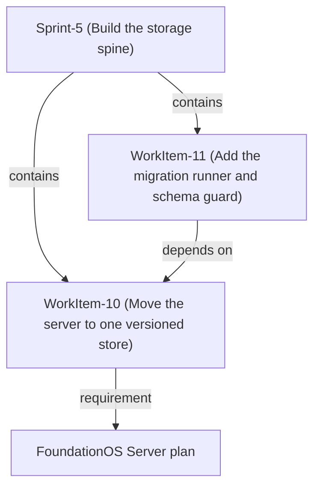

# scrumWorkSpace

Use these Markdown components in conversation with the owner. Choose the smallest view that answers the question. Examples show layout. Query the workspace for the current values before presenting them.

## Shared vocabulary

| Element | Display |
|---|---|
| Record headings | 📦 PI-1 (FoundationOS Server) · 🏁 Sprint-5 (Build the storage spine) · 🎫 WorkItem-10 (Move the server to one versioned store) |
| Types | ✨ Feature · 🛠️ Task · ⚙️ Enabler · 🐞 Bug · 🔧 Enhancement |
| Status, in every view | 💭 Proposed · 🟢 Ready · ▶️ Active · 👀 Review · ✅ Done |
| Priority, highest first | 🔴 P-1 · 🟠 P-2 · 🟠 P-3 · 🟡 P-4 · 🟢 P-5 |
| Effort, lowest first | 🟢 Ef-1 · 🟡 Ef-2 · 🟠 Ef-3 · 🟠 Ef-4 · 🔴 Ef-5 |
| Severity for bugs | Sev-1 highest through Sev-5 lowest |
| Knowledge | 📄 Document · 📝 Draft · ◆ Decision · ⚠️ Blocker · 🧪 Evidence · 🔗 Relationship |

Use the exact title in parentheses whenever naming a PI, sprint or work item. Use the sprint number within its PI and the stable project-wide work-item number. Group cross-PI sprint lists by titled PI. Keep stored IDs for tool calls and machine fields. Preserve original wording inside quotations. Keep text beside each status or type icon, including in tables and short answers. Show the colour and grade together for every priority or effort value, including short answers and both sides of a change receipt. P-2 and P-3 share the orange band. Preserve source quotations verbatim. Use heading icons once per section.

## 📦 PI overview

**📦 PI-{number} ({title})**  
**Target v{version}** · {status icon and label} · {sprint count}

Lead with the outcome. List titled sprints in numerical order with their recorded statuses. State which PI targets development setup when its version is `none`. Include a version discrepancy or pending acceptance only when supported by evidence.

## 🏁 Sprint bucket

**🏁 Sprint-{number} ({title})**  
**PI-{number} ({title})** · **Target v{version}** · {sprint status icon and label}

**Acceptance** · {sprint acceptance}

| Work item | Type | Status | ⚑ Priority | Effort |
|---|---|---|---|---|
| ☐ **WorkItem-{number} ({title})** | 🛠️ Task | 👀 Review | 🔴 P-1 | 🟡 Ef-2 |
| ☑ **WorkItem-{number} ({title})** | ⚙️ Enabler | ✅ Done | 🟠 P-2 | 🟠 Ef-3 |

Use ☑ only for stored status `done` and ☐ for every other status. These are display indicators. Order by priority then ID. End with the completed count over the total. Fetch all pages before computing totals or label the displayed subset. For an empty sprint give the heading, acceptance and “0 work items.”

## 🎫 Work-item detail

**🎫 WorkItem-{number} ({title})**  
**PI-{number} ({title})** › **Sprint-{number} ({title})** · **Target v{version}**

| Type | Status | ⚑ Priority | Effort |
|---|---|---|---|
| 🛠️ Task | 👀 Review | 🔴 P-1 | 🟡 Ef-2 |

**Acceptance** · {observable outcome}  
**🧪 Recorded evidence** · {what was verified, on which version, with a source}

For a 🐞 Bug, add severity and the observed behaviour. Give the affected version separately when it differs from the PI target. Label missing evidence or unassigned severity when it matters. A checkmark in a sprint row comes from status alone.

## 📄 Documents and 📝 drafts

List the authored title as a link, scope and revision. For an open document show the requested passage or summary. For impact questions, follow backlinks and list titled work items with the recorded link purpose. For an empty result state the searched scope, e.g. “📝 Drafts · No project drafts recorded.”

## Notes and decisions

**◆ Decision · {date}**  
{Decision and its consequence in one or two sentences.}  
**Recorded on** · {titled record and link to its journal}

Select progress, investigation, blocker, decision or handoff notes to fit the question. Lead with the latest applicable note. Identify a superseded decision when the chronology explains a change.

## 🔗 Relationships

Use a breadcrumb for one parent chain. For a branching question, use a compact labelled diagram. Example using abbreviated node keys internally:

Resolve containment from parent records, document relationships from purpose-labelled references and dependencies from explicit source wording. Identify inferred relationships in prose.

## Why are we doing it this way?

Lead with the answer. Quote the shortest passage that supports each distinct reason. Identify the authored document and section, draft revision, note and date, or titled work item and field. Link each excerpt directly to its source. Read the actual body before quoting. A draft records a proposal. A decision note can establish approval. An acceptance criterion establishes expected behaviour. Identify your inference wherever the sources leave a step unstated.

For example, if asked why the server checks the store version at startup:

> “An older copy that meets a newer schema refuses to start.”  
> **📄 Server plan · Upgrade rule** · [Read the plan](../../../../scrumWorkspace/documents/PI-01/server-increment-plan.md)

> “a newer server copy upgrades the store, and an older copy never corrupts it.”  
> **⚙️ WorkItem-11 (Add the migration runner and schema guard) · Acceptance** · [Read the item](../../../../scrumWorkspace/work-items/WI-011.json)

Together these sources explain the guard: after an upgrade, an older copy must stop before it can write data using assumptions from the earlier schema. If the sources disagree, quote both positions and identify the latest recorded decision. If no rationale is recorded, say what the sources establish and what is still open.

## Search, short answers and change receipts

Return one sentence for a single field. For example, “**WorkItem-4 (Verify durable state)** is **🔴 P-1**, the highest priority.” For searches, show the filter, matching titled records and the visible range when paginated. For updates, show the confirmed change, e.g. **WorkItem-{number} ({title})** · ⚑ Priority **🟠 P-2 → 🔴 P-1**. For a rejected write, describe the current recorded state and the reason.
